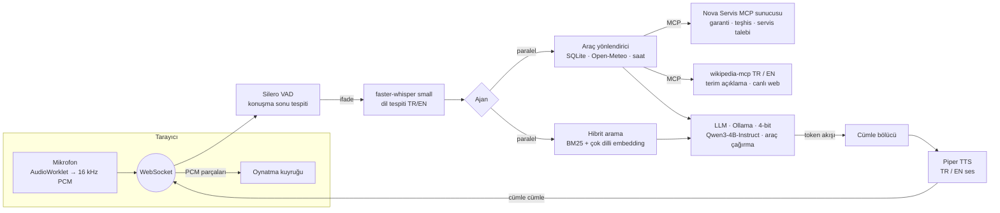

# Nova — Uçtan Uca Sesli Yapay Zeka Ajanı

Kullanıcıyı mikrofondan dinleyen, konuşulan dili (Türkçe / İngilizce) algılayıp **aynı dilde**, **yalnızca bilgi
kaynaklarına (doküman, SQLite veritabanı, canlı API) dayanarak** cevap veren ve cevabı doğal sesle okuyan,
tamamen açık kaynak bileşenlerle çalışan bir sesli asistan.

> Kodun ve tasarım kararlarının dosya dosya ayrıntılı anlatımı: [PROJE_REHBERI.md](PROJE_REHBERI.md).

> Bilgi tabanındaki **"Nova Robotik"** şirketi, ürünleri, siparişleri ve servis merkezleri **kurgusaldır**; sistemin
> kaynaklara bağlı cevap üretip üretmediğini ölçebilmek için hazırlanmış örnek veridir.

```
Mikrofon ─► VAD (Silero) ─► STT (Whisper) ─► Ajan: RAG + araçlar + LLM (Ollama) ─► cümle cümle TTS (Piper) ─► Hoparlör
                 ▲                                                                        │
                 └──────────── kullanıcı araya girerse (barge-in) üretim anında iptal ◄───┘
```

---

## 1. Kurulum

Dört adım: indir, başlat, **"NOVA HAZIR"** yazısını bekle, konuş. `.env` dosyası ya da API anahtarı gerekmez.

### Adım 1: Projeyi indirin

```bash
git clone https://github.com/AbdullahKarakoc/akinrobotics-nova-voice-agent.git
cd akinrobotics-nova-voice-agent
```

### Adım 2: Başlatın (birini seçin)

**A. Ekran kartıyla (önerilen).** Gereken: Docker Desktop ve bilgisayarda kurulu, açık [Ollama](https://ollama.com).
AMD kartlarda güncel sürücü gerekir. İlk ses ~6 sn.

```bash
docker compose -f docker-compose.yml -f docker-compose.host-ollama.yml up --build agent
```

**B. Yalnızca Docker (ekran kartı yok).** Gereken: yalnızca Docker Desktop. İşlemcide çalıştığı için daha yavaştır:
ilk ses ~16 sn.

```bash
docker compose up --build
```

> Ekran kartı neden yalnızca A'da kullanılıyor? Docker Desktop (Windows) AMD ekran kartını konteynere
> geçirmiyor. Bu yüzden A'da dil modeli (LLM) bilgisayardaki Ollama'da çalışır, geri kalan her şey Docker'da.

### Adım 3: "NOVA HAZIR" yazısını bekleyin

İlk açılışta modeller bir kez indirilir. İnternet hızına göre **10-20 dakika** sürebilir; sonraki açılışlar
1-2 dakikadır. Terminalde sırasıyla şu çerçeveli mesajları görürsünüz:

```
================================================================
  İLK AÇILIŞ: ses ve arama modelleri indiriliyor (~0.8 GB)
================================================================
...
================================================================
  LLM İNDİRİLİYOR: hf.co/unsloth/Qwen3-4B-Instruct-2507-GGUF:IQ4_XS
================================================================
app.llm.ollama_llm: llm download 10% (227 / 2270 MB)
app.llm.ollama_llm: llm download 20% (454 / 2270 MB)
...
================================================================
  NOVA HAZIR  ->  http://localhost:8000
================================================================
```

**"NOVA HAZIR" çıkmadan konuşursanız** ajan "Dil modelim henüz hazır değil…" der. Bu bir hata değildir,
indirmenin bitmesini bekleyin. Durumu tarayıcıdan da görebilirsiniz:
`http://localhost:8000/health` → `"llm_status"`: `downloading` (iniyor) → `loading` (belleğe yükleniyor) → `ready`.

Çerçevede **"LLM HAZIR DEĞİL"** görürseniz bir sorun var demektir. Altındaki hata satırına bakın. Genellikle Ollama
kapalıdır (A) ya da internet veya disk alanı yetmemiştir. Ajan 10 saniyede bir yeniden dener.

B kurulumunda dil modelini ayrı bir konteyner (`ollama-pull`) indirir. İlerlemesi o konteynerin satırlarında
görünür. Ayrıca Ollama imajı (~9.4 GB) da bir kez indirilir.

### Adım 4: Konuşun

Tarayıcıda **http://localhost:8000** adresini açın, mikrofon düğmesine **bir kez** basın ve konuşun. Sonraki
sorularda tekrar basmanız gerekmez; "Dinlemeyi durdur" mikrofonu kapatır.

> Mikrofon tarayıcıda yalnızca `localhost` veya HTTPS üzerinden açılır. Kulaklıksız kullanımda ajan kendi sesini
> duyup kendini kesiyorsa `.env` içine `BARGE_IN=false` yazın.

### Ayarlar ve seçenekler

| Ne istiyorsunuz? | Nasıl |
|---|---|
| Daha hızlı ama daha az doğru küçük model (A) | `LLM_MODEL_GPU=qwen3:1.7b-q4_K_M` ile başlatın (ilk ses ~3.4 sn) |
| Daha hızlı ama daha az doğru küçük model (B) | `LLM_MODEL=qwen3:1.7b-q4_K_M docker compose up` (ilk ses ~7.6 sn, daha çok uydurma, §4.3) |
| Modelin ekran kartında olduğunu görmek (A) | `ollama ps` → "10%/90% CPU/GPU" |
| Başka bir ayarı değiştirmek | `cp .env.example .env` ve düzenleyin; tüm seçenekler [app/config.py](app/config.py) içinde |

| Kurulum | LLM | Nerede çalışır | İlk ses (bu dizüstü, p50) |
|---|---|---|---|
| **A. Ekran kartı** | Qwen3-4B-Instruct-2507, 4-bit IQ4_XS (2.1 GB) | Bilgisayardaki Ollama (%90 GPU) | **~6 sn** |
| B. Yalnızca Docker | Qwen3-4B-Instruct-2507, 4-bit Q4_K_M (2.5 GB) | Konteynerdeki Ollama, CPU | ~16 sn |
| B + küçük model | Qwen3 1.7B, 4-bit Q4_K_M (1.3 GB) | Konteynerdeki Ollama, CPU | ~7.6 sn |

A'nın ayarları [docker-compose.host-ollama.yml](docker-compose.host-ollama.yml) dosyasındadır: ajan
`host.docker.internal:11434`'teki Ollama'ya bağlanır, bağlam 3072 token, LLM'in CPU'da kalan katmanları için
4 iş parçacığı (§2.2). SQLite veritabanı (`data/seed.sql`'den) ilk açılışta otomatik oluşturulur.

### Docker'sız (geliştirme)

```bash
python -m venv .venv && .venv/Scripts/activate      # Linux/macOS: source .venv/bin/activate
pip install -r requirements-dev.txt
cp .env.example .env                                # ayar şablonu (gizli bilgi içermez; isteğe bağlı)
# Ollama kurulu ve açık olmalı (https://ollama.com); LLM'i ajan ilk açılışta kendisi indirtir.
# Model .env'deki LLM_MODEL: GPU'da hf.co/unsloth/Qwen3-4B-Instruct-2507-GGUF:IQ4_XS önerilir.
python -m scripts.download_models                   # Whisper, Piper sesleri, embedding modeli
python -m app                                       # http://localhost:8000
pytest                                              # 41 birim testi, model gerektirmez (MCP testleri sunucuyu yerelde başlatır)
```

### Diğer giriş noktaları

| Komut / uç nokta | Ne yapar |
|---|---|
| `GET /` | Web arayüzü (konuşma, kaynaklar, tur başına gecikme dökümü) |
| `WS /ws` | Sesli konuşma protokolü (16 kHz PCM giriş, PCM + JSON olay çıkışı) |
| `POST /api/chat` `{"text": "..."}` | Aynı ajanla metin tabanlı konuşma (test/hata ayıklama) |
| `GET /api/metrics` | Tüm turların gecikme istatistikleri (ortalama, p50, p90) |
| `python -m scripts.evaluate` | Doğruluk / halüsinasyon değerlendirmesi ([eval/questions.json](eval/questions.json)) |
| `python -m scripts.benchmark_voice` | Gerçek zamanlı ses akışıyla uçtan uca gecikme ölçümü |

---

## 2. Mimari



| Katman | Seçim | Neden |
|---|---|---|
| Konuşma algılama | **Silero VAD v6** (ONNX, 2 MB) | 32 ms'lik pencere başına < 1 ms CPU; enerji tabanlı VAD'lere göre gürültüye dayanıklı. 500 ms sessizlik = tur sonu; kısa duraklamalar turu bölmez. |
| Konuşma tanıma | **faster-whisper `small` int8** (CTranslate2) | TR+EN'i ve **dil tespitini tek modelde** yapar; int8 ile CPU'da hızlı. Varsayılan çözümleme yolu yerine özel tek geçişli kısa pencere çözümlemesi ile, gerçek seste aynı doğrulukta ~4 kat (kısa komutlarda daha fazla) hızlandırıldı (§4.4). |
| Dil modeli | **Ollama** + **Qwen3-4B-Instruct-2507, 4-bit** — GPU'da IQ4_XS (2.1 GB), CPU'da Q4_K_M (2.5 GB). Hızlı seçenek: Qwen3 1.7B Q4_K_M (düşünme kapalı) | Açık ağırlıklı (Apache-2.0), Türkçesi ve araç çağırması iyi. 4B Instruct: düşünme modu olmayan, talimat takibi için eğitilmiş sürüm; 1.7B'ye göre alan dışı ve STT'nin bozduğu sorularda belirgin biçimde daha az uydurma (ret 3/5 → 4/5, kaynaksız sayı 1 → 0, §4.3). IQ4_XS, 4 GB kartın kullanılabilir ~2.9 GB'ına %90 sığıyor; CPU'da k-quant (Q4_K_M) daha hızlı. 4-bit kuantizasyon fp16'ya göre ~3.5 kat az bellek; bu boyutta kalite kaybı küçük. Ollama: tek komutla model yönetimi (Hugging Face GGUF dahil), CPU/GPU (Vulkan), prompt (KV) önbelleği. Seçim 5 model ölçülerek yapıldı (§4.3). |
| Bilgi tabanı | **Hibrit arama**: BM25 (Türkçe için 5 harf kök kesme) + `paraphrase-multilingual-MiniLM-L12-v2` (fastembed / ONNX) | Türkçe soru İngilizce dokümanı bulabilir (diller arası); BM25 "T5", "E02" gibi kodları yakalar. PyTorch gerektirmez (imaj küçük). Küçük korpus için NumPy yeterli. |
| Araçlar | **SQLite** (sipariş, fiyat/stok, servis merkezi), **Open-Meteo** (hava, anahtarsız), saat/tarih | Ödevdeki "doküman + veritabanı + API" kaynak türlerinin üçü de var. Değişken veriler (fiyat, stok) dokümanda değil veritabanında. |
| Harici araçlar | **MCP** (Model Context Protocol, resmi `mcp` Python SDK): kendi "Nova Servis" sunucumuz (garanti, uzaktan teşhis, servis talebi) + üçüncü taraf **wikipedia-mcp** (robotik terimlerini açıklama) | Başka bir ekibin sistemine ve hazır, açık kaynak bir sunucuya kod bağımlılığı olmadan, aynı protokolle bağlanmayı gösterir; yeni bir sunucu ajan kodu değişmeden `MCP_SERVERS` ile eklenir (§2.5). |
| Ses sentezi | **Piper** (VITS, ONNX) `tr_TR-dfki-medium`, `en_US-ryan-medium` | CPU'da gerçek zamanın ~10 katı hızlı (RTF ≈ 0.1), her iki dilde ses var, tamamen yerel. |
| Taşıma / arayüz | **FastAPI + WebSocket**, tarayıcıda AudioWorklet | Tam çift yönlü akış: kullanıcı ajan konuşurken araya girebilir. Kurulum gerektirmeyen istemci. |

### 2.1 Tasarım ilkeleri

* **Her bileşen değiştirilebilir.** STT, TTS ve LLM birer küçük arayüzün (`transcribe`, `synthesize`, `stream_chat`)
  arkasında; seçim yapılandırma ile yapılır ([app/stt](app/stt), [app/tts](app/tts), [app/llm](app/llm)).
  LLM için iki arka uç var: **Ollama** yerel API'si ve **OpenAI uyumlu** herhangi bir sunucu (vLLM, llama.cpp
  `llama-server`, LM Studio, OpenAI, Groq…): `LLM_BACKEND=openai LLM_BASE_URL=http://host:8080/v1 LLM_MODEL=...`.
  Tek bir kapalı servise bağımlılık yok; varsayılan kurulum tamamen yerel ve internetsiz çalışır (hava durumu ve Wikipedia araçları hariç; internet
  yoksa bu iki araç "bilgi şu an yok" döner).
* **Yeni bilgi kaynağı eklemek:** `data/docs/` klasörüne `.md`/`.txt` dosyası bırakmak yeterli; açılışta parçalanıp
  indekslenir (embedding'ler içerik özetine göre önbelleklenir).
* **Yeni araç eklemek:** bir fonksiyon + dekoratör:
  ```python
  @registry.tool("get_invoice", "Fatura tutarını ve son ödeme tarihini getirir.",
                 {"invoice_no": {"type": "string"}},
                 router=lambda text: ...)   # isteğe bağlı: niyet kesinse argümanları döndür
  def get_invoice(invoice_no: str) -> dict: ...
  ```
  Şema LLM'e otomatik verilir; hata/zaman aşımı yakalanıp modele "bilgi şu an yok" olarak iletilir
  ([app/tools/registry.py](app/tools/registry.py)).
* **Gözlemlenebilirlik:** her log satırı `oturum/tur` kimliği taşır; her tur için tek satırlık metrik logu
  (STT, arama, LLM ilk token, TTS, uçtan uca) ve kullanılan kaynaklar yazılır. `LOG_JSON=true` ile JSON log.

### 2.2 Gecikmeyi düşürmek için yapılanlar

Bu donanımda (§4.1) en pahalı adım LLM'in **prompt işleme (prefill)** süresidir: yalnızca CPU ile `qwen2.5:3b`
saniyede ~25-30, `qwen2.5:1.5b` ~50-65 token işleyebiliyor; GPU'da bile 4B model ilk tokene ~2 sn harcıyor. Bu yüzden
optimizasyonların çoğu "LLM'e daha az token göstermek" ve "beklemeyi paralelleştirmek" üzerine:

1. **Akışlı ve boru hatlı üretim:** LLM tokenları cümlelere bölünür; ilk cümle biter bitmez sentezlenip gönderilir,
   LLM bu sırada sonraki cümleyi üretir. Kullanıcı cevabın tamamını beklemez.
2. **Önbellek dostu prompt düzeni:** sistem promptu ve araç şemaları her turda birebir aynıdır → Ollama'nın KV önbelleği
   bunları yeniden işlemez. Tura özgü her şey (bağlam, araç verisi, dil talimatı) en sondaki kullanıcı mesajında.
3. **Az ama isabetli bağlam:** en iyi 2 parça + en iyi skorun 0.15 altındakileri at; alaka eşiğinin altında bağlam hiç yok.
4. **Deterministik araç yönlendirme:** "340 numaralı sipariş", "T5'in fiyatı", "Ankara'da hava" gibi niyeti kesin
   sorular, LLM'e sorulmadan regex ile tanınır; araç **arama ile paralel** çalışır ve sonuç bağlama eklenir. Bu, ikinci bir
   LLM turunu (prefill + üretim) tamamen ortadan kaldırır ve küçük modellerin araç çağırmayı "unutması" sorununu çözer.
   Yönlendiricinin kaçırdığı durumlarda LLM'in kendi araç çağırması yedek olarak çalışır; o durumda araç beklenirken
   "Bir saniye, kontrol ediyorum." dolgu cümlesi söylenir.
5. **Whisper için tek geçiş + kısa pencere:** standart yol sesi 30 sn'ye tamamlar ve dil bilinmiyorsa encoder'ı iki kez
   çalıştırır. Encoder çıktısını hem dil tespiti hem çözümleme için kullanan ve yalnızca "ifade + 2 sn" uzunluğunda
   pencere kodlayan özel yol, 2-3 sn'lik bir cümlede STT süresini **~6.5-11 sn → ~1 sn**'ye indirdi; gerçek insan
   sesinde (FLEURS) Türkçe WER değişmedi (%21.3 → %20.9). Kısa pencerenin bilinen yan etkisi olan tekrar döngüleri,
   süreyle orantılı token sınırı + tekrar kırpma ile engellendi ([app/stt/faster_whisper_stt.py](app/stt/faster_whisper_stt.py)).
6. **Araya girme (barge-in):** kullanıcı konuşmaya başladığında oynatma anında durur ve LLM'e giden HTTP akışı kapatılır
   (sunucu üretimi keser). Kullanıcı cevap gelmeden önce yalnızca duraksayıp devam ettiyse, iki parça birleştirilip tek
   ifade olarak işlenir — cümlenin ilk yarısı kaybolmaz.
7. **Modeller bir kez yüklenir ve ısıtılır;** LLM açılışta sistem promptuyla çağrılarak önbelleğe alınır (model
   Ollama'da yoksa önce indirtilir). Ollama iş parçacığı sayısı (`LLM_NUM_THREAD=8`) bu işlemcide CPU'da prefill'i
   ~%35 hızlandırdı; GPU kurulumunda 4 (CPU'da kalan birkaç katman TTS ile yarışmasın, §4.2).
8. **GPU belleğine sığdırma:** 4 GB'lık kartta model + bağlam belleği sığmazsa katmanlar CPU'ya taşar ve üretim
   yavaşlar. Bağlam penceresi gerçek prompt uzunluğuna göre 4096 → 3072'ye indirildi (en uzun tek tur prompt ~1000
   token), GPU için daha küçük bir 4-bit kuantizasyon (IQ4_XS) seçildi (§4.3).

### 2.3 Doğruluk ve halüsinasyon kontrolü

| Katman | Önlem |
|---|---|
| Kaynak zorunluluğu | Sistem promptu: şirket/ürün/sipariş/fiyat bilgisi **yalnızca** verilen bağlam, araç sonucu veya canlı veriden; yoksa "bu bilgiye sahip değilim" + neye yardım edebileceği. Alan dışı sorular (genel kültür vb.) bilerek reddedilir. |
| Açık "bilgi yok" sinyali | Arama, kalibre edilmiş bir eşiğin (0.45) altındaysa modele bağlam yerine **"(no relevant information found)"** verilir. Ölçümlerde en etkili önlem bu oldu (§4.3: bu sinyalin olmadığı "full" modunda model genel müdür adı uydurdu). |
| Yapılandırılmış veri araçtan | Fiyat, stok, sipariş durumu, adres, hava durumu modelin hafızasından değil araçtan gelir; araçlar bulunamayan kayıt için açıkça `found: false` döner. |
| Yanlış biçimli araç çağrısı | Küçük modeller bazen araç çağrısını düz metin JSON olarak yazar; bu metin **seslendirilmez**, ayrıştırılıp gerçek araç çağrısına çevrilir. |
| Seslendirme öncesi sayı kontrolü | Her cümle **okunmadan önce** kontrol edilir: içindeki bir sayı soru, bağlam ve araç çıktılarının hiçbirinde yoksa cümle okunmaz, yerine "Bu konuda kaynaklarımda kesin bir bilgi yok." denir (gerçek kullanımda "pil ömrü fiyatı 499 lira" gibi bir uydurma böyle durduruldu). Ayrıca loglanır ve arayüzde ⚠ ile gösterilir. |
| Şeffaflık | Her cevabın altında kullanılan doküman parçaları ve araç çağrıları gösterilir ve loglanır. |
| Örnekleme | Düşük sıcaklık (0.2), kısa cevap (en fazla 200 token). |
| STT kaynaklı hatalar | Whisper'ın sessizlikte uydurduğu bilinen ifadeler ("Altyazı M.K.", "Thanks for watching"), konuşma-yok olasılığı yüksek çıktılar ve tekrar döngüleri atılır. Tarayıcıda 48 → 16 kHz dönüşümü 63 katsayılı FIR alçak geçiren filtreyle yapılır (eski tek kutuplu filtre 12 kHz'i yalnızca 5 dB bastırıp s/z/r seslerini konuşma bandına katlıyordu; yeni filtre 96 dB); tarayıcının gürültü bastırması kapalı. Yanlış duyulan ürün adları ("Zehbe Z2", "Vehbar ve iki" → "Rehber R2") regex ile düzeltilir, araç yönlendirici bitişik/bozuk yazımları da tanır ("havanası" → hava durumu), LLM'e de konuşmanın tanıma hatası içerebileceği söylenir. |
| Tekrar döngüsü | Küçük modellerin aynı cümleyi tekrar tekrar üretmesi: aynı cümle ikinci kez seslendirilmez. |
| Model boyutu | GPU'da 4B model: alan dışı ve bozuk tanınmış sorularda 1.7B'ye göre belirgin biçimde daha az uydurma (§4.3). |
| Ölçüm | [scripts/evaluate.py](scripts/evaluate.py): 26 soruluk sabit set (TR+EN) ile olgu doğruluğu, kaynakta olmayan soruda doğru ret (cevapta yasak ifade, ör. "Ankara", geçmemeli), araç seçimi, cevap dili ve kaynaksız sayı oranı ölçülür. |

### 2.4 Çok dillilik

Dil, Whisper'ın dil tespitiyle **ses üzerinden** belirlenir ve desteklenen dillerle (TR, EN) sınırlandırılır (kısa
Türkçe ifadeler aksi halde Azerice vb. sanılabiliyor). Cevap dili LLM'e hedef dilde verilen bir talimatla bildirilir
("Yalnızca Türkçe cevap ver."), TTS sesi de dile göre seçilir. Yazılı girişte basit bir işlev-kelimesi sayacı kullanılır.
Bilgi tabanı karışık dillidir (bazı dokümanlar İngilizce); çok dilli embedding ile Türkçe soru İngilizce dokümandan
cevaplanabilir. Yeni dil eklemek: `LANGUAGES`, bir Piper sesi ve iki kısa metin (dolgu/hata cümlesi).

### 2.5 MCP araçları (Model Context Protocol)

Ajan, açılışta `MCP_SERVERS`'taki sunuculara bağlanır ([app/tools/mcp_tools.py](app/tools/mcp_tools.py)).
`tools/list` ile araçları keşfeder ve kayıt defterine yerel araçlarla aynı biçimde ekler; zaman aşımı ve hata
yönetimi de aynıdır. Her oturum kendi arka plan olay döngüsünde yaşar, böylece eşzamanlı (senkron) açılış kodundan
kurulabilir ve istekler arasında açık kalır. Sunucular paralel başlatılır. Açılamayan sunucu loglanıp atlanır,
ajan diğer araçlarıyla çalışmaya devam eder. Varsayılan olarak iki tür sunucu bağlıdır:

**1. Nova Servis (kendi sunucumuz):** [mcp_servers/nova_service](mcp_servers/nova_service). Başka bir ekibin satış
sonrası sistemini temsil eder. Ajan bu sunucunun kodunu import etmez. Kendi kurgusal verisi vardır ve araçları salt
okunurdur.

| Araç | Ne döner | Yönlendirici (LLM'siz) |
|---|---|---|
| `check_warranty` | Seri numarasına göre garanti (standart/uzatılmış), batarya garantisi, periyodik bakım durumu | seri no (4 hane) + "garanti/bakım" |
| `get_robot_diagnostics` | Uzaktan teşhis: çevrimiçi mi, pil %, yazılım sürümü, aktif hata kodu ve müşterinin yapabileceği | seri no + "çalışmıyor/hata/şarj/ne durumda…" |
| `get_service_ticket_status` | Servis talebinin durumu, teknisyen ziyareti, beklenen çözüm tarihi | talep no (2 hane) + "talep/kayıt/ticket" |

**2. Wikipedia (üçüncü taraf, açık kaynak sunucu):** [`wikipedia-mcp`](https://github.com/rudra-ravi/wikipedia-mcp),
canlı Wikipedia API'sine gider. TR ve EN için iki ayrı örnek çalışır. Tek görevi, müşterinin cevaplarda ve
dokümanlarda karşılaştığı **robotik/teknoloji terimlerini açıklamaktır**: "LiDAR nedir?", "SLAM ne demek?",
"What is a humanoid robot?".

| Sunucunun sunduğu | Ajanın aldığı |
|---|---|
| 22 araç (11'i önekli kopya) | yalnızca `get_summary` (`wikipedia_tr_` / `wikipedia_en_` önekiyle) |
| LLM'in seçtiği araç | **yalnızca yönlendirici çağırır**, şema LLM'e hiç gösterilmez (`llm_visible=false`) |
| 4.700 karaktere kadar özet | cümle sonundan kesilmiş en fazla 500 karakter (`max_chars`) |

Bu sınırların nedeni ölçümlerde görüldü:

* `get_summary` başlığı birebir istiyor ("LiDAR" bulunamıyor, "LIDAR" var).
* Arama sonuçları konudan kayabiliyor: "lidar" aramasının ikinci sonucu Şanlıurfa'daki "Lidar Höyük".
* Asıl risk, ajanın genel kültür botuna dönüşmesiydi.

Bu yüzden terimler ve doğrulanmış madde başlıkları sabit bir sözlükte duruyor ([app/tools/wikipedia.py](app/tools/wikipedia.py)).
Yönlendirici yalnızca "X nedir / ne demek / what is X" kalıbında ve X sözlükteyse çalışır. Türkçe maddesi olmayan
terimler (SLAM, OTA) İngilizce maddeden cevaplanır. Soru bizim ürünümüzle ilgiliyse ("Rehber R2'nin sensörleri
nedir?") Wikipedia çağrılmaz, cevap dokümandan gelir. Web metni yalnızca bilinen maddelerden geldiği için prompt
injection yüzeyi de küçük kalıyor.

**Sunucu ayarları** (`MCP_SERVERS`, JSON liste). Bir girdi ya bir dize ya da bir nesnedir:

```json
["python -m mcp_servers.nova_service",
 {"target": "python -m wikipedia_mcp --language tr", "tools": ["get_summary"],
  "prefix": "wikipedia_tr_", "llm_visible": false, "max_chars": 500}]
```

* `target`: stdio ile başlatılacak komut ya da Streamable HTTP adresi (`http://host:8765/mcp`). Nova Servis'i ayrı
  çalıştırmak için `python -m mcp_servers.nova_service --http` kullanılır. MCP Inspector veya Claude Desktop da bağlanabilir.
* `MCP_SERVERS='["python -m mcp_servers.nova_service"]'`: Wikipedia olmadan, tamamen internetsiz çalışır.
  `MCP_SERVERS=[]`: tüm MCP araçları kapalı.

**Bu projenin kurallarına nasıl uyuyor:**

* **Yönlendiriciler ajan tarafında, araç adına göre tanımlı.** Bunlar ajanın gecikme stratejisinin parçası, veri
  kaynağının değil. Seri numarası 4 (R2-3100), sipariş numarası 3 (340), servis talebi numarası 2 hanelidir (26).
  Numaralar kısa ve söylemesi kolay seçildi, çünkü "bin üç" ya da "yirmi bir bin beş yüz yedi" gibi uzun sayıları
  konuşma tanıma sık yanlış yazıyordu. Yönlendiriciler hane sayısı sayesinde birbirine karışmaz. Yıl gibi görünen
  sayılar (1900-2099) ve "sipariş" geçen sorular seri numarası sayılmaz.
* **Genel web araçları LLM'e verilmez.** Her ek şema, 4B modelin araç seçimini zorlaştırır ve önbelleklenen
  prompt'u büyütür. Wikipedia'nın LLM'e eklediği şema sayısı sıfırdır.
* **Araç çıktısında karar metin olarak yazılır.** İlk sürümde `"in_warranty": false` dönülüyordu, model ise
  "garantisi devam ediyor" dedi. "expired on 2026-05-20" bile yetmedi, çünkü model bugünün tarihini bilmiyor. Şimdi
  sonuç baştan veriliyor: `"garanti YOK: garanti süresi 2026-05-20 tarihinde doldu"`. Bu değişiklikten sonra
  denenen 5 garanti sorusunun 5'inde olgu doğruydu.

**Ölçülen maliyet** (§4.1 donanımı):

* **Açılış:** üç sunucu paralel başlıyor, bağlantı + araç keşfi toplam ~5.9 sn (sırayla ~11 sn olurdu).
  Modeller yüklenirken geçtiği için kullanıcı hissetmez.
* **Nova Servis (yerel stdio):** ilk çağrı ~125-160 ms, sonra **12-24 ms**. Yerel SQLite aracı ~7 ms. ~6 sn'lik bir
  turda ölçülebilir bir fark yaratmıyor.
* **Wikipedia (canlı web):** çağrı başına **~0.7-1.0 sn**. Arama ile paralel çalışıyor ama yine de terim sorularında
  ilk sesi bu kadar geciktiriyor. Ayrıca bu sorularda daha zengin bağlam olduğu için cevaplar da uzun: "LiDAR nedir?"
  ve "Yapay zeka nedir?" toplam ~14-15 sn, kısa cevaplı "SLAM ne demek?" ~8 sn. İlk cümle akışla okunduğu için bu
  sürenin tamamı beklenmiyor.

**Mevcut davranış bozuldu mu?** 26 soruluk eval (GPU, IQ4_XS), önce yalnızca Nova Servis, sonra Wikipedia da açıkken
iki kez tekrar çalıştırıldı. Doğruluk sayıları her ikisinde de değişmedi (metrikler: §4.3): 24/26 geçti, olgu doğruluğu 18/19, doğru ret 4/5, araç
seçimi 7/7, dil 26/26, kaynaksız sayı 0. Medyan gecikme 5847 → 5995 / 5936 ms, ilk token 1910 → 1980 / 1978 ms. Bu
fark ölçüm gürültüsü düzeyinde. Eval'deki alan dışı sorularda Wikipedia hiç çağrılmadı.

### 2.6 Araçlar: hangi soru hangi aracı çağırır

Bir araç iki yoldan çağrılır:

1. **Yönlendirici (router), LLM'den önce:** soruda niyet kelimesi ve gereken bilgi (numara, şehir, ürün, terim)
   birlikte varsa araç regex ile tanınır ve doküman aramasıyla **paralel** çalışır. Sonuç LLM'e "LIVE DATA" olarak
   hazır verilir, ikinci bir LLM turu gerekmez. Bir soruda birden çok yönlendirici tetiklenebilir; hepsi paralel çalışır.
2. **LLM'in kendi araç çağrısı (yedek yol):** yönlendirici tetiklenmezse (bilgi eksik, alışılmadık ifade) model
   araç şemalarına bakıp kendisi çağırabilir. Tur başına en fazla 2 araç turu yapılır. Araç beklenirken "Bir saniye,
   kontrol ediyorum." denir. Wikipedia araçları bu yolda **yoktur**: LLM onları görmez.

| Araç | Kaynak | Ne döner | Yönlendirici ne zaman çağırır | Örnek soru |
|---|---|---|---|---|
| `get_order_status` | SQLite | Sipariş durumu, tahmini teslim | "sipariş/order" + 3-7 haneli numara | "340 numaralı siparişim ne durumda?" |
| `get_product_info` | SQLite | Liste fiyatı (KDV hariç), stok, teslim süresi | "fiyat/ücret/kaç para/stok/satın al/teslim/price/cost/stock/buy" + ürün adı, kodu veya takma adı | "Taşıyıcı T5'in fiyatı ne kadar?", "How much does the education kit cost?" |
| `find_service_center` | SQLite | Servis merkezi adresi ve telefonu | "servis/tamir/service center" + şehir | "İzmir'de servis merkeziniz var mı?" |
| `get_weather` | Open-Meteo (canlı web) | Sıcaklık, hava durumu, günlük min/maks | hava kelimeleri ("hava nasıl", "sıcaklık", "weather") + şehir | "Ankara'da hava nasıl?" |
| `get_current_datetime` | Sistem saati | Tarih, gün, saat (İstanbul) | "saat kaç / bugün günlerden ne / what time" | "Saat kaç?" |
| `check_warranty` | MCP · Nova Servis | Garanti VAR/YOK ve bitiş tarihi, batarya garantisi, bakım durumu | 4 haneli seri no + "garanti/bakım/warranty/maintenance" | "4500 seri numaralı robotumun garantisi devam ediyor mu?" |
| `get_robot_diagnostics` | MCP · Nova Servis | Çevrimiçi mi, pil %, yazılım sürümü, aktif hata ve öneri | 4 haneli seri no + "çalışmıyor/hata/arıza/şarj/ne durumda/status/offline" | "3200 numaralı robotum çalışmıyor." |
| `get_service_ticket_status` | MCP · Nova Servis | Talep durumu, teknisyen ziyareti, beklenen çözüm | 2 haneli numara + "talep/kayıt/başvuru/ticket/request" | "37 numaralı servis talebim ne durumda?" |
| `wikipedia_tr_get_summary` | MCP · wikipedia-mcp (TR, canlı web) | Türkçe madde özeti (≤ 500 karakter) | Türkçe "nedir/ne demek/nasıl çalışır" + sözlükteki terim (Türkçe maddesi varsa) | "LiDAR nedir?", "Yapay zeka ne demek?" |
| `wikipedia_en_get_summary` | MCP · wikipedia-mcp (EN, canlı web) | İngilizce madde özeti (≤ 500 karakter) | İngilizce "what is/what does … mean" + sözlükteki terim; ya da Türkçe maddesi olmayan terim | "What is a humanoid robot?", "SLAM nedir?" |

**Araç çağırmayan sorular:**

| Soru | Ne olur |
|---|---|
| "Rehber R2'nin pil ömrü ne kadar?" | Fiyat/stok kelimesi yok, bilgi sorusu: dokümandan (RAG) cevaplanır. |
| "Rehber R2'nin sensörleri nedir?" | Bizim ürünümüzle ilgili: Wikipedia değil, doküman. |
| "Garanti süresi ne kadar?" | Numara yok, genel politika: doküman. |
| "Siparişim ne durumda?" / "Hava nasıl?" | Numara veya şehir yok, yönlendirici tetiklenmez. LLM eksik bilgiyi kullanıcıya sorar. Sipariş aracını numarasız çağırırsa araç "numara yok, kullanıcıya sor" döner. |
| "340 numaralı siparişim ne durumda?" | "Ne durumda" geçiyor ama numara 3 haneli ve "sipariş" var: robot teşhisi değil, sipariş aracı. |
| "2025'te aldığım robot çalışmıyor." | 2025 bir yıl, seri numarası değil: teşhis aracı çağrılmaz. |
| "Türkiye'nin başkenti nedir?" | Alan dışı. Hiçbir araç çağrılmaz, model reddetmelidir (bu soru küçük modellerin bilinen zayıflığı, §5). |

Yönlendiriciler: yerel araçlar için [app/tools/database.py](app/tools/database.py) ve
[app/tools/web_apis.py](app/tools/web_apis.py), MCP araçları için [app/tools/mcp_tools.py](app/tools/mcp_tools.py) ve
[app/tools/wikipedia.py](app/tools/wikipedia.py). Örnek soruların hepsi birim testlerinde doğrulanıyor
([tests/test_tools.py](tests/test_tools.py), [tests/test_mcp_tools.py](tests/test_mcp_tools.py)).

---

## 3. Proje yapısı

```
app/
  audio/vad.py              Silero VAD akışı + konuşma sonu (endpointing) durum makinesi
  stt/                      STT arayüzü + faster-whisper (tek geçiş, kısa pencere)
  llm/                      LLM arayüzü + Ollama ve OpenAI-uyumlu akışlı istemciler
  tts/                      TTS arayüzü + Piper
  knowledge/                doküman parçalama, Türkçe BM25, embedding, hibrit arama
  tools/                    araç kayıt defteri, yönlendiriciler, SQLite ve web API araçları, MCP istemcisi,
                            Wikipedia terim sözlüğü
mcp_servers/nova_service/   bağımsız MCP sunucusu: garanti, robot teşhisi, servis talebi (kendi örnek verisiyle)
  agent/                    promptlar, ajan döngüsü (arama → LLM → araçlar), metin yardımcıları
  pipeline/session.py       WebSocket oturumu: VAD → STT → ajan → TTS, barge-in, metrikler
  main.py                   FastAPI: arayüz, /ws, /api/chat, /api/metrics, /health
web/                        tarayıcı istemcisi (AudioWorklet yakalama, oynatma kuyruğu, arayüz)
data/docs/                  bilgi tabanı dokümanları (TR + EN), data/seed.sql örnek veritabanı
eval/questions.json         değerlendirme seti
scripts/                    model indirme, değerlendirme, sesli benchmark, rapor tablosu
reports/                    ölçüm çıktıları (JSON)
tests/                      birim testleri (sahte LLM/VAD ile, model gerektirmez)
Dockerfile                  ajan imajı (modeller imaja gömülmez, ilk açılışta /models birimine iner)
docker-compose.yml          B kurulumu: ollama + ollama-pull + agent (CPU)
docker-compose.host-ollama.yml  A kurulumu (override): bilgisayardaki Ollama + GPU ayarları
.env.example                ayar şablonu
```

---

## 4. Ölçüm sonuçları

**Özet (son hal, bu dizüstü):**

| | A. GPU (önerilen) | B. Tamamen Docker (CPU) |
|---|---|---|
| LLM | Qwen3-4B-Instruct-2507 IQ4_XS | Qwen3-4B-Instruct-2507 Q4_K_M |
| Kullanıcı sustu → ilk ses (p50) | **6.0 sn** | 16.0 sn |
| Doğruluk seti (26 soru, GPU'da ölçüldü) | 24/26 geçti, kaynaksız sayı 0, ret 4/5 | aynı model ailesi |
| STT (Whisper small, CPU) | ~1.3 sn, Türkçe WER %20.9 (gerçek ses) | aynı |

Ayrıntılar ve ara adımlar aşağıda; tüm ham çıktılar [reports/](reports/) klasöründe.

### 4.1 Donanım

| | |
|---|---|
| İşlemci | AMD Ryzen 7 3750H (4 çekirdek / 8 iş parçacığı, 2.3-4.0 GHz, 2019 dizüstü) |
| Bellek | 16 GB DDR4 (yaklaşık 14 GB kullanılabilir) |
| GPU | Radeon RX 560X 4 GB (+ dahili Vega 10). Eski sürücüyle (2020) Ollama kartı görmedi → ilk ölçümler **yalnızca CPU**. Sürücü güncellendikten sonra (31.0, 2026) Ollama kartı **Vulkan** ile kullanıyor; 1.7B modelin 29/29 katmanı, 4B Instruct modelin ~%90'ı GPU'da (kullanılabilir VRAM ~2.9 GB). |
| Yazılım | Windows 11, Python 3.11, Ollama 0.40.2 (yerel), Docker Desktop 29.8 |

§4.4, §4.3'ün ilk tablosu ve §4.2'deki CPU ölçümü yalnızca CPU ile; "GPU" etiketli ölçümlerde yalnızca LLM GPU'da,
STT/TTS yine CPU'da.
Docker Desktop (WSL2) AMD GPU'yu konteynere geçirmediği için GPU kullanımı **ana makinedeki Ollama** ile
(`docker-compose.host-ollama.yml`) mümkün.

### 4.2 Uçtan uca sesli gecikme

`scripts/benchmark_voice.py`: 8 soru (5 TR, 3 EN) × 2 tekrar. Sorular Piper ile sese çevrilip WebSocket üzerinden
**gerçek zamanlı** (32 ms paketlerle, tarayıcının yaptığı gibi) gönderilir; süre, istemcinin son konuşma örneğini
gönderdiği andan ilk ajan sesini aldığı ana kadar ölçülür. Yalnızca CPU (`qwen3:1.7b`, RAG,
`LLM_NUM_THREAD=8`), 16 tur ([reports/voice_qwen3-1-7b_rag.json](reports/voice_qwen3-1-7b_rag.json)):

| Adım | p50 | p90 | Not |
|---|---|---|---|
| Konuşma sonu tespiti (VAD) | 0.65 sn | 0.68 sn | 500 ms sessizlik eşiği + çerçeve payı |
| STT (faster-whisper small) | 0.88 sn | 1.18 sn | **RTF 0.42** (2-3 sn'lik ifadeler) |
| Bilgi tabanında arama | 11 ms | 14 ms | embedding + BM25 |
| LLM ilk token | 3.0 sn | 4.2 sn | üretim hızı ~9 token/sn |
| TTS ilk cümle | 1.0 sn | 2.2 sn | **RTF 0.21** (LLM ile aynı anda çalışırken; tek başına RTF ≈ 0.10) |
| **Kullanıcı sustu → ilk ajan sesi** | **7.6 sn** | **10.7 sn** | ortalama 7.3 sn |

Yorum: CPU'da gecikmenin ~%40'ı LLM, ~%15'i STT, ~%10'u VAD bekleme süresi. Ses gelmeye başladıktan sonra
TTS gerçek zamandan hızlı olduğu için konuşma kesintisiz akar.

**Tüm yapılandırmalar karşılaştırmalı** — ajan Docker'da; GPU sütunlarında Ollama ana makinede (RX 560X, Vulkan),
8'er tur. **"GPU, 4B Instruct" sütunu önerilen A kurulumu, son sütun B kurulumudur.** GPU + 1.7B:
[reports/voice_qwen3-1-7b-q4_rag_gpu.json](reports/voice_qwen3-1-7b-q4_rag_gpu.json).

| Adım (p50) | CPU, 1.7B | GPU, 1.7B | GPU, 4B Instruct IQ4_XS | Tam Docker (CPU), 4B Instruct Q4_K_M |
|---|---|---|---|---|
| Konuşma sonu tespiti (VAD) | 0.65 sn | 0.70 sn | 0.75 sn | 0.68 sn |
| STT (CPU, konteynerde) | 0.88 sn | 1.24 sn (RTF 0.55) | 1.28 sn | 1.19 sn |
| LLM ilk token | 3.0 sn | **0.72 sn** | 1.97 sn | 10.4 sn (p90 15.5) |
| LLM üretim hızı | ~9 token/sn | **~26 token/sn** | ~8.6 token/sn | ~4.2 token/sn |
| TTS ilk cümle | 1.0 sn | **0.31 sn** (RTF 0.10) | 0.56 sn (RTF 0.15) | 0.57 sn (RTF 0.17) |
| **Kullanıcı sustu → ilk ajan sesi** | 7.6 sn | **3.4 sn** | 6.0 sn | 16.0 sn (p90 24.2) |

Son sütun `docker compose up`'ın varsayılanı (B) ([reports/voice_qwen3-4b-instruct-q4km_rag_cpu_docker.json](reports/voice_qwen3-4b-instruct-q4km_rag_cpu_docker.json)):
tüm modeller konteynerde, GPU yok. Cevaplar doğru (8/8 kaynaklı, ret ve araç doğru), ama 4B modelin CPU'da prefill'i
(~1000 token'lık ilk prompt dahil) ilk sesi ~16 sn'ye çıkarıyor; açılıştaki ısınma 85 sn sürüyor. Bu bilinçli bir
doğruluk tercihi. Aynı makinede GPU yolu (`docker-compose.host-ollama.yml`) 6.0 sn, 1.7B ile tam Docker ~7.6 sn.

4 GB'lık giriş seviyesi bir GPU bile 1.7B modelde LLM süresini ~4 kat kısalttı. GPU'da varsayılan yine de 4B: ilk ses
~2.6 sn gecikiyor, karşılığında alan dışı ve bozuk tanınmış sorularda belirgin biçimde daha az uydurma var (§4.3).
Hız öncelikliyse `LLM_MODEL_GPU=qwen3:1.7b-q4_K_M`. 4B'nin GPU'ya sığmayan birkaç katmanı CPU'da çalıştığı için
GPU kurulumunda `LLM_NUM_THREAD=4`: 8 iş parçacığında bu katmanlar, aynı anda çalışan TTS ile yarışıyordu (ilk ses 7.4 sn,
TTS ilk cümle 1.1 sn). 4B ölçümü: [reports/voice_qwen3-4b-instruct-iq4_rag_gpu.json](reports/voice_qwen3-4b-instruct-iq4_rag_gpu.json).
8 turluk küçük örneklemler; mertebe olarak değerlendirilmeli.

> Not: Piper'ın Türkçe sesi robotik olduğu için bu testte Türkçe tanıma hataları gerçek kullanımdan kötüdür
> ("Rehber R2" → "Vehber ve iki"); gecikme ölçümü için geçerli, doğruluk için §4.4'teki gerçek ses ölçümü esas alınmalı.

### 4.3 Doğruluk / halüsinasyon ve LLM seçimi

**Yalnızca CPU, ilk set:** [eval/questions.json](eval/questions.json) setinin ilk hali, 24 soru (13 TR + 11 EN; sonradan
26'ya çıktı, aşağıdaki GPU tablosu). 18'inde beklenen bilgi kaynaklarda var,
4'ünde **yok** (genel kültür, kaynakta olmayan ürün ağırlığı, kaynakta olmayan genel müdür adı) — bunlarda doğru davranış
"bilmiyorum" demektir; 7'si araç gerektirir. Her soru yeni bir konuşmada, `/api/chat` üzerinden sorulur
(`python -m scripts.evaluate`, tüm yapılandırmalar için `scripts/eval_matrix.ps1`). Çıktılar: [reports/](reports/).

**Metrikler ne anlama geliyor:**

* **Olgu (olgu doğruluğu):** cevabı kaynaklarda olan sorularda ajan doğru bilgiyi verdi mi? Cevapta beklenen
  ifade geçmeli; örneğin pil ömrü sorusunda "8".
* **Doğru ret:** cevabı kaynaklarda olmayan sorularda ajan uydurmak yerine "bu bilgiye sahip değilim" dedi mi?
  Bu, halüsinasyon testidir. Cevapta ret ifadesi olmalı. Kaynakta olmayan bir sayı ya da yasak bir ifade (ör.
  başkent sorusunda "Ankara") geçmemeli.
* **Geçen:** sorunun tüm kontrolleri (olgu/ret, araç, dil) başarılı.

| LLM | Bilgi modu | Geçen | Olgu doğruluğu | Doğru ret | Araç seçimi | Cevap dili | Kaynaksız sayı içeren cevap | LLM ilk token p50 | Toplam cevap p50 |
|---|---|---|---|---|---|---|---|---|---|
| **qwen3:1.7b** | **rag** | **23/24** | **18/18** | **3/4** | 7/7 | 24/24 | **0** | 3.0 sn | 6.9 sn |
| qwen3:1.7b | full | 22/24 | 18/18 | 2/4 | 7/7 | 24/24 | 0 | 3.7 sn | 8.2 sn |
| qwen2.5:3b | rag | 22/24 | 18/18 | 3/4 | 7/7 | 23/24 | 1 | 4.6 sn | 10.6 sn |
| qwen2.5:3b | full | 20/24 | 17/18 | 1/4 | 7/7 | 24/24 | 1 | 3.3 sn | 8.9 sn |
| qwen2.5:1.5b | rag | 20/24 | 17/18 | 1/4 | 7/7 | 24/24 | 0 | 2.4 sn | 5.3 sn |
| qwen2.5:1.5b | full | 20/24 | 17/18 | 1/4 | 7/7 | 24/24 | 0 | 1.9 sn | 5.4 sn |

Tablodaki tüm LLM'ler 4-bit (Q4_K_M) çalıştı: Ollama'nın `qwen3:1.7b`, `qwen2.5:3b`, `qwen2.5:1.5b` etiketleri
Q4_K_M dosyasını gösterir (`qwen3:1.7b` ile `qwen3:1.7b-q4_K_M` aynı model katmanı: `3d0b790534fe`).
"Toplam cevap" metin cevabının tamamının üretilme süresidir; sesli kullanımda kullanıcı ilk cümleyi çok daha önce duyar (§4.2).

**Çıkarımlar ve seçimler**

* **Bu tablodaki seçim: `qwen3:1.7b` + `rag`.** CPU'da en doğru ve 3B modelden daha hızlı yapılandırma; kaynaksız tek
  bir sayı bile üretmedi. Sonradan varsayılan 4B oldu (aşağıda); 1.7B hızlı seçenek olarak duruyor.
* **"full" (tüm bilgi tabanı önbellekli sistem promptunda)** prefill'i ortadan kaldırdığı için 3B modelde ilk token süresini
  ~%30 kısalttı, ama her modelde **ret oranı düştü**: modeller kaynakta olmayan bilgiyi uydurdu (ilk denemede
  "genel müdür Ahmet Yılmaz", "Temizlik C3 68 kg" — başka ürünün ağırlığı). Her turda arama sonucunun kimliklerini
  ("ilgili: K3, K7" / "ilgili bilgi yok") eklemek bunu kısmen düzeltti ama RAG'ın seviyesine çıkaramadı. Korpus küçük
  olduğu için seçenek olarak duruyor (`KNOWLEDGE_MODE=full`); doğruluğun öncelikli olduğu varsayılan RAG.
* **Model boyutu halüsinasyon için belirleyici:** `qwen2.5:1.5b`, "ilgili bilgi bulunamadı" sinyaline rağmen genel müdür
  için isim uydurdu ("Kadir Tanrıverdi"). Daha hızlı olsa da varsayılan yapılmadı.
* **Hiçbir küçük model "Türkiye'nin başkenti" sorusunu reddetmedi** (cevap doğru ama kapsam dışı; 1.5B bir denemede
  "İstanbul" dedi). Bu, prompt ile çözülemeyen bir model sınırı; kritik kullanımda alan dışı soru sınıflandırıcısı eklenebilir.

**Son seçim — GPU ile daha büyük model (RX 560X 4 GB, Vulkan, RAG, 26 soru).** Sette sonradan eklenenler: canlı kullanımda görülen
iki hata — "Akınsoft şirketi nerede?" (1.7B "Ankara'da" diye uydurdu) ve STT'nin bozduğu "Zehbe Z2'nin piyomru ne
kadar?" (1.7B: "1999 yılında üretildi"). Ret sorularına `forbid` eklendi: cevapta "Ankara" geçen ret başarısız sayılır.

| LLM (hepsi 4-bit) | VRAM'e sığan | Geçen | Olgu | Doğru ret | Kaynaksız sayı | İlk token p50 | Üretim hızı |
|---|---|---|---|---|---|---|---|
| qwen3:1.7b Q4_K_M | %100 | 23/26 | 18/19 | 3/5 | 1 | 1.2 sn | ~26 token/sn |
| qwen3:4b Q4_K_M (2.5 GB) | %75 | 24/26¹ | 19/19 | 3/5¹ | 0 | 2.5 sn | ~8 token/sn |
| **Qwen3-4B-Instruct-2507 IQ4_XS (2.1 GB)** | %90-95 | **24/26** | 18/19² | **4/5** | **0** | 1.9 sn | ~9-10 token/sn |

¹ Dünya Kupası sorusunu doğru reddetti ama o sırada betik "cannot provide" kalıbını tanımıyordu; sonradan eklendi.
² Kalan hata "Zehbe Z2": bu test yazılı yoldan gider; sesli yolda STT düzeltme tablosu onu zaten "Rehber R2'nin pil
ömrü"ne çevirir. Kalan ret hatası her modelde aynı: "Türkiye'nin başkenti" sorusuna "Ankara" diyorlar.

Kartta kullanılabilir alan ~2.9 GB (Ollama günlüğü). `qwen3:4b` sığmadığı için CPU'ya taşıyor ve yavaşlıyor. Instruct-2507,
aynı 4B boyutunda düşünme modu olmayan, talimat takibi için eğitilmiş sürüm; daha küçük 4-bit kuantizasyonu (IQ4_XS) ve
3072 bağlamla neredeyse tamamı GPU'ya sığıyor. GPU kurulumunun varsayılanı bu (`docker-compose.host-ollama.yml`).
Bedeli gecikme: üretim 1.7B'nin ~1/3'ü hızında (§4.2). Doğruluk gecikmeden önemli görüldüğü için tam Docker
kurulumunda (CPU) da varsayılan 4B: aynı modelin CPU'da daha hızlı çalışan Q4_K_M sürümü (`docker-compose.yml`).

**Geliştirme sürecinde aynı set ile ölçülen etkiler** (qwen2.5:3b, RAG):

| Aşama | Geçen | Araç seçimi | LLM ilk token p50 |
|---|---|---|---|
| İlk sürüm: araçları yalnızca LLM çağırıyor, top-3 bağlam, 4 iş parçacığı | 18/24 | 5/7 | 10.2 sn |
| + deterministik araç yönlendirme, top-2 + bağıl kesme, 8 iş parçacığı | 21/24 | 7/7 | 5.2 sn |
| + prompt düzeltmeleri, metin olarak yazılan araç çağrısının onarımı, eşik kalibrasyonu | 22/24 | 7/7 | 4.6 sn |

Alaka eşiği (0.45) veriyle seçildi: değerlendirme setindeki bilgi sorularının en iyi arama skoru ≥ 0.62, set dışından
eklenen 9 alakasız soru dahil alan dışı soruların skoru ≤ 0.43. Eşik bu setle kalibre edildiği için yeni sorularda
biraz iyimser olabilir.

### 4.4 STT: gerçek insan sesiyle doğruluk ve hız

`scripts/benchmark_stt.py`: Google FLEURS test setinden (gerçek konuşmacılar, CC-BY 4.0) dil başına 15 kayıt,
ortalama 10.5 sn. Kelime hata oranı (WER) ve RTF, `small` int8, 4 iş parçacığı:

| Çözümleme yolu | TR WER | TR süre / ifade | TR RTF | EN WER | EN RTF |
|---|---|---|---|---|---|
| Standart faster-whisper (otomatik dil tespiti, 30 sn pencere) | 21.3% | 12.8 sn | 1.07 | 7.7% | 1.15 |
| Tek geçiş, 30 sn pencere + domain promptu | 35.9% | 6.8 sn | 0.57 | 9.8% | 0.74 |
| Tek geçiş, kısa pencere + domain promptu | 35.5% | 2.9 sn | 0.24 | 9.8% | 0.23 |
| **Tek geçiş, kısa pencere, promptsuz (varsayılan)** | **20.9%** | **3.0 sn** | **0.28** | – | – |

* Tek geçiş + kısa pencere, standart yolla **aynı Türkçe doğrulukta ~4 kat hızlı**; 2-3 sn'lik sesli komutlarda kazanç
  daha büyük (~7-11 sn → ~1 sn). Dil tespiti tüm kayıtlarda doğru (30/30).
* Ölçüm önemli bir hatayı ortaya çıkardı: ürün adlarını Whisper'a "önceki metin" olarak vermek (hotwords) Türkçe WER'i
  **%21 → %36**'ya çıkarıyordu. Bu yüzden kaldırıldı; ürün adları artık çözümlemeden sonra küçük bir düzeltme tablosuyla
  normalleştiriliyor ([app/stt/domain_terms.py](app/stt/domain_terms.py): "Rehber ve iki" → "Rehber R2").
* Son satır yalnızca TR için ölçüldü (EN satırları domain promptlu sürümle alındı; prompt EN'de etkisi küçüktü: 7.7 → 9.8).

**Daha büyük model denendi mi? (`medium`, aynı 15 TR kaydı, ortalama 11.9 sn):**

| Model / pencere | TR WER | 12 sn'lik ifade | 2.5 sn'lik komut |
|---|---|---|---|
| **small, kısa pencere (varsayılan)** | 20.9% | 3.0 sn | **1.1 sn** |
| medium, kısa pencere | 23.7% | 11.8 sn | 4.0 sn |
| medium, 30 sn pencere | **12.2%** | 26.1 sn | — (çok yavaş) |

`medium` Türkçe hatayı neredeyse yarıya indiriyor, ama yalnızca tam 30 sn pencereyle — kısa pencere `small`'ın
doğruluğunu korurken `medium`'unkini bozuyor. Bu CPU'da 30 sn pencereli `medium` canlı konuşma için fazla yavaş, bu
yüzden varsayılan `small`. `medium` kullanılacaksa `STT_MODEL=medium STT_DYNAMIC_WINDOW=false` birlikte ayarlanmalı
(GPU'lu bir makinede mantıklı). Bu makinede doğruluğu artırmanın yolu Whisper'ı da GPU'ya almak: CTranslate2'nin AMD
desteği yok, whisper.cpp'nin Vulkan arka ucu ise RX 560X'te çalışabilir (yeni bir STT arka ucu; denenmedi — whisper.cpp
Windows için hazır Vulkan derlemesi yayınlamıyor, derlemek için Visual Studio + Vulkan SDK gerekiyor).

**Diğer STT ayarları (small, aynı TR kayıtları):** beam search (`STT_BEAM_SIZE=5`) WER'i 20.9% → 19.5%'e indiriyor
ama 3 sn'lik komuta ~0.3 sn ekliyor; kapalı. İş parçacığı sayısı ortama bağlı: Windows'ta doğrudan çalışırken 8 iş
parçacığı daha hızlı (1.25 → 1.10 sn), Docker (WSL2) içinde ise daha yavaş (uçtan uca ölçümde STT 1.27 → 1.91 sn);
varsayılan 4.

### 4.5 Ölçümleri tekrar üretmek

```bash
python -m scripts.benchmark_stt --n 15            # STT: gerçek insan sesiyle WER / RTF (FLEURS, ~15 dk)
python -m app &                                    # sunucu
python -m scripts.benchmark_voice --repeat 2      # uçtan uca sesli gecikme
python -m scripts.evaluate                        # doğruluk / halüsinasyon
powershell -File scripts/eval_matrix.ps1          # tüm LLM × bilgi modu kombinasyonları (Windows)
powershell -File scripts/eval_matrix.ps1 -Configs "hf.co/unsloth/Qwen3-4B-Instruct-2507-GGUF:IQ4_XS|rag" -Port 8001 -Suffix _gpu
                                                  # tek model, Docker'daki ajan 8000'de açıkken
python -m scripts.report_table                    # README tablosu
```

---

## 5. Sınırlamalar ve sonraki adımlar

* **Donanım darboğazı.** Yalnızca CPU ile ilk ses ~7.6 sn, bunun büyük kısmı LLM. LLM giriş seviyesi bir GPU'ya (RX 560X)
  alınınca ~3.4 sn'ye indi; mimari hiç değişmedi, yalnızca Ollama'nın çalıştığı yer değişti. GPU'da daha doğru 4B
  modeli seçmek ilk sesi ~6 sn'ye çıkarıyor (4 GB kart modelin tamamını alamıyor). 8 GB'lık bir kart 4B'yi tamamen
  GPU'ya alır ve bu farkı kapatır; `LLM_BACKEND=openai` ile vLLM de bir seçenek.
* **GPU yalnızca ana makinedeki Ollama ile:** Docker Desktop (WSL2) AMD GPU'yu konteynere geçirmiyor; GPU için
  `docker-compose.host-ollama.yml` kullanılmalı. Tam konteyner kurulumu (`docker compose up`) CPU'da çalışır ve
  4B model orada belirgin biçimde yavaştır (ilk ses ~16 sn, §4.2); hız gerekiyorsa `LLM_MODEL=qwen3:1.7b-q4_K_M`.
* **STT akışlı değil:** ifade bittikten sonra çözümlenir (~1 sn). Akışlı/artımlı tanıma (ör. konuşurken kısmi çözümleme)
  bu süreyi neredeyse sıfırlar; bir sonraki en büyük kazanç bu.
* **Sentetik test sesi:** uçtan uca benchmark Piper sesleriyle yapıldı; Piper'ın tek Türkçe sesi oldukça robotik olduğundan
  bu testlerdeki Türkçe tanıma hataları gerçek kullanımdan kötüdür. STT doğruluğu bu yüzden ayrıca gerçek insan sesiyle
  (FLEURS) ölçüldü (§4.4).
* **Küçük modellerin sınırları:** alan dışı genel kültür sorusunu cevaplayabiliyor (4B dahil hiçbir model
  "Türkiye'nin başkenti" sorusunu reddetmedi), araç çıktısını nadiren yanlış okuyabiliyor
  (bir denemede araçtan gelen "Cuma"yı "Cumartesi" dedi). Sayısal uydurmalar sayı kontrolüyle yakalanıyor; sözel olanlar
  yakalanmıyor. Daha güçlü bir model ya da cevap sonrası LLM tabanlı doğrulama (ek gecikme pahasına) bunu azaltır.
* **Yankı:** hoparlörle kullanımda araya girme, tarayıcının yankı gidermesine güvenir; kulaklık önerilir ya da `BARGE_IN=false`.
* **Kimlik doğrulama yok:** sipariş, seri numarası ve servis talebi sorguları yalnızca numarayla yapılır; gerçek
  sistemde müşteri doğrulaması gerekir. Bu yüzden MCP araçları müşteri adı döndürmez ve hiçbiri veri yazmaz
  (sesle servis talebi açmak doğrulama + onay adımı ister).
